<!-- Header -->
<p align="center">
  
</p>

<p align="center">
  <a href="https://reljod.com">
    
  </a>
</p>

<p align="center">
  <a href="https://reljod.com"></a>
  <a href="https://linkedin.com/in/reljodoreta"></a>
  <a href="https://kita-agents.dev"></a>
  
</p>

---

### 👋 Hi, I'm Reljod

I turn slow, manual review work in banks and financial firms into AI systems that run in production. Seven years in software, from computer vision prototypes to a Philippine digital bank, and now building multi-agent LLM systems with the evaluations that keep them honest.

```python
class Reljod:
    role       = "AI Engineer · Senior Full-Stack Engineer"
    based_in   = "Philippines 🇵🇭 (open to work anywhere)"
    focus      = ["multi-agent LLM systems", "document AI", "KYC & compliance", "GraphRAG"]
    principle  = "Ship, measure, iterate. Show the artifact, not the title."
    background = "BS Electronics Engineering · Licensed ECE"
    off_hours  = ["calisthenics 🤸", "property development 🏗️", "reading AI research 📚"]
```

### 🧪 Reljod Labs: live at [reljod.com](https://reljod.com)

<p align="center">
  <a href="https://reljod.com/#demos"></a>
</p>

| Demo | What it does |
| --- | --- |
| 📄 **Document Compliance** | Pre-screens a banking onboarding pack against a compliance rulebook. |
| 🐈 **Ledger, the cat banker** | Answers questions about me by taking my About page apart. |
| 🏦 **Teller** | A Specialist agent for pension and trust operations: runs review pipelines, asks for what's missing. |
| 🕸️ **Client Manager** | Builds a wealth client's knowledge graph in Postgres and answers by walking it (GraphRAG). |

All demos run real models on synthetic data. **On the bench:** in-house KYC automation, a name matching engine, tampering and illegibility detection, and more.

### 🏆 Selected work

- 💸 Helped replace a third-party **KYC** vendor with an in-house AI solution at a digital bank: **-90% KYC cost**, **+7 pts approval rate**, **+8 pts automation**.
- 🧹 Designed a multi-agent eligibility pipeline that screens out **95 to 97%** of ineligible records before a single LLM report is generated.
- 🚀 Shipped **20+ AI proofs of concept**, from RAG and GraphRAG to OCR, computer-use and voice agents.
- 🎾 First AI system ever: a computer vision line caller for tennis (OpenCV, YOLO, PyTorch).

### 🛠️ Tech I reach for

<p align="center">
  <br/>
  
</p>

<p align="center">
  
  
  
  
  
  
  
  
  
  
  
  
</p>

### 🔭 Building now

- **[kita-agents.dev](https://kita-agents.dev)**: AI assistants for Filipino small businesses and government services, in Taglish. Open framework: [Kita-PH](https://github.com/Reljod/Kita-PH) (FastAPI) + [kita-ph-ui](https://github.com/Reljod/kita-ph-ui) (Next.js).
- **[reljod.com](https://reljod.com)**: more financial-services demos, one bench item at a time.

### 📈 Activity

<p align="center">
  
</p>

<p align="center">
  <picture>
    <source media="(prefers-color-scheme: dark)" srcset="https://raw.githubusercontent.com/Reljod/Reljod/output/github-snake-dark.svg" />
    <source media="(prefers-color-scheme: light)" srcset="https://raw.githubusercontent.com/Reljod/Reljod/output/github-snake.svg" />
    
  </picture>
</p>

<p align="center">
  <a href="https://reljod.com"><b>Have manual review work that should be an AI pipeline? Let's talk at reljod.com →</b></a>
</p>


